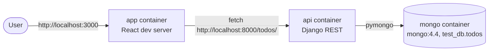

# Adbrew TODO App: High-Level Design

A full-stack to-do app built for the Adbrew backend intern assignment: React front end, Django REST API and MongoDB, each in its own Docker container. For code-level detail see the [Low-Level Design](lld.md).

## 1. Containers



## 2. Components

| Service | Image / build | Port | Role |
|---|---|---|---|
| `app` | Dockerfile (Node 16 + Yarn) | 3000 | React UI: list, create, delete to-dos |
| `api` | Dockerfile (Python 3.8) | 8000 | Django REST Framework `TodoListView` |
| `mongo` | `mongo:4.4` | 27017 | Stores to-dos; data mounted to `${ADBREW_CODEBASE_PATH}/db` |

## 3. Tech

| Layer | Choice |
|---|---|
| Front end | React (Create React App), `fetch` |
| Back end | Django + Django REST Framework, `pymongo` (no Django ORM for to-dos) |
| Database | MongoDB 4.4 |
| Orchestration | Docker Compose |

## 4. Run

```bash
export ADBREW_CODEBASE_PATH=$(pwd)/src
docker compose up --build
```
