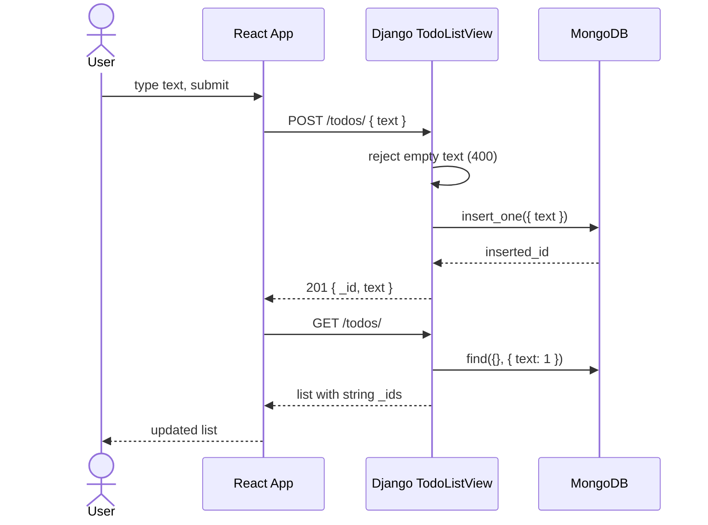

# Adbrew TODO App: Low-Level Design

For the big picture see the [High-Level Design](hld.md).

## 1. API (`src/rest/rest`)

| Method | Route | Body | Response |
|---|---|---|---|
| GET | `/todos/` | | `200 [{ _id, text }]` |
| POST | `/todos/` | `{ text }` | `201 { _id, text }`, or `400` if text is empty |
| DELETE | `/todos/` | `{ _id }` | `200 { message: "Todo deleted" }` |

All three return `500 { error }` on failure. MongoDB is reached at `mongodb://$MONGO_HOST:$MONGO_PORT` (set to `mongo:27017` in the Dockerfile), database `test_db`, collection `todos`.

## 2. Document

```json
{ "_id": "ObjectId as string in responses", "text": "Buy milk" }
```

## 3. Front end (`src/app/src/App.js`)

| State / function | Behavior |
|---|---|
| `todos`, `todo`, `loading`, `error` | List, input text, loading and error messages |
| `fetchTodos()` | GET list on mount and after each create |
| `handleSubmit()` | POST new to-do, refetch, clear input |
| `handleDelete(id)` | DELETE by `_id`, remove from the list locally |

## 4. Create flow


